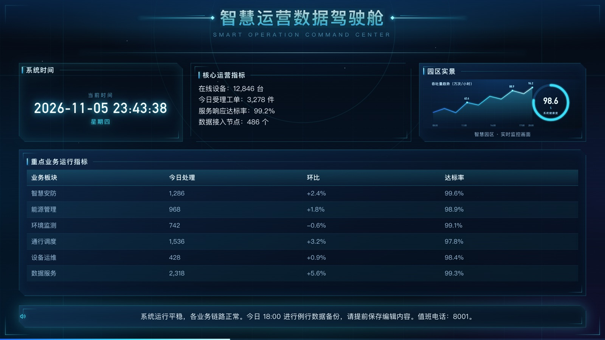
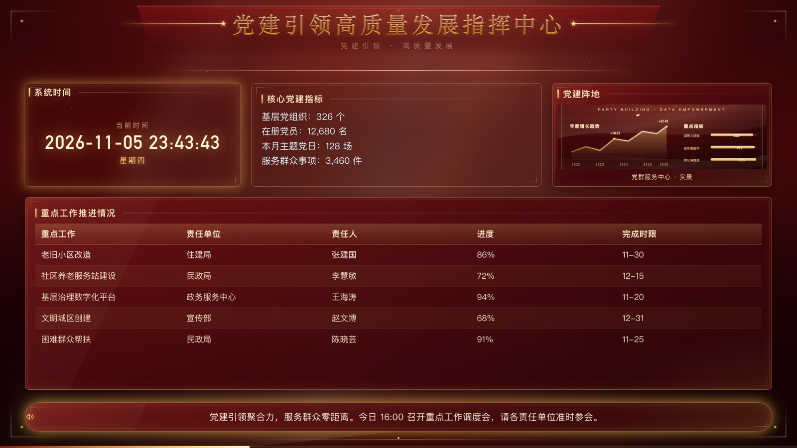
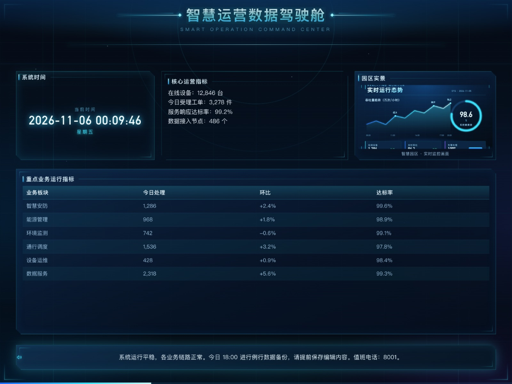
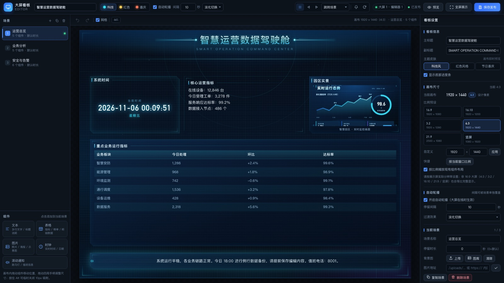

# BigScreen Dashboard

[简体中文](README.md) | English

[](https://github.com/xiufeng666/bigscreen-dashboard/actions/workflows/ci.yml)
[](https://github.com/xiufeng666/bigscreen-dashboard/releases)
[](LICENSE)

An **offline, self-hosted, single-binary big-screen dashboard** for intranets and control rooms.

Write with Go standard library only — the entire frontend (HTML/CSS/vanilla JS) is embedded into one
executable with `go:embed`. No database, no Node.js, no npm, no CDN, no internet required at runtime.

- **Display page** — configurable design canvas (default 1920×1080; also 4:3 / 3:2 / 16:10 / 21:9 / portrait),
  aspect-ratio-aware scaling with themed letterboxing, three visual themes, server-authoritative scene rotation.
- **Remote editor** — visual drag & drop layout, 8-way resize, snapping, undo/redo, scene management,
  image upload, templates, JSON import/export, version-conflict protection.
- **Real-time control** — SSE pushes config changes, play/pause, next/prev/goto, notifications and
  refresh commands to every connected screen.
- **Kiosk ready** — `?kiosk=1` hides cursor and overlay controls; `?scene=N` opens a specific scene.

## Screenshots

| Tech theme | Red theme |
|---|---|
|  |  |

| 4:3 canvas (non-16:9) | Editor with canvas settings |
|---|---|
|  |  |

## Quick start

### Option A — download a release (recommended)

Download from [GitHub Releases](https://github.com/xiufeng666/bigscreen-dashboard/releases):

| Platform | Asset |
|---|---|
| Windows x64 / x86 | `bigscreen-server_windows_amd64.exe` / `_windows_386.exe` |
| macOS Apple Silicon / Intel | `bigscreen-server_darwin_arm64` / `_darwin_amd64` |
| Kylin / UOS / Linux x86_64 | `bigscreen-server_linux_amd64` |
| Kylin ARM / Linux arm64 | `bigscreen-server_linux_arm64` |

Or grab the `bigscreen-v1.1.0-all-platforms.zip` / `bigscreen-v1.1.0-kylin-uos-linux.tar.gz` bundle.

```bash
# Linux / Kylin / UOS
chmod +x bigscreen-server_linux_amd64 start.sh
./start.sh -port 8080 -data ./data -password 'your-password'

# macOS (Apple Silicon)
chmod +x bigscreen-server_darwin_arm64
./bigscreen-server_darwin_arm64 -port 8080 -data ./data -open
```

Windows: put `start.bat` next to `bigscreen-server_windows_amd64.exe` and double-click it.

Then open in any browser on the LAN:

- Display: `http://<server-ip>:8080/` (use `/?kiosk=1` for wall displays, F11 for fullscreen)
- Editor: `http://<server-ip>:8080/editor`

### Option B — build from source

```bash
git clone https://github.com/xiufeng666/bigscreen-dashboard.git
cd bigscreen-dashboard
go build -o bigscreen-server ./server
./bigscreen-server -port 8080 -data ./data
# cross-compile all six platforms into dist/
scripts/build-all.sh
```

Requires Go 1.22+. No third-party dependencies.

## Canvas / screen ratios

The design canvas is configurable (`canvas: {width, height}`), defaulting to 1920×1080. Open the editor,
deselect all widgets, then **Dashboard settings → Canvas size** and pick a preset or enter a custom size:

| Screen ratio | Suggested canvas |
|---|---|
| 16:9 | 1920×1080 |
| 16:10 | 1920×1200 |
| 3:2 | 1920×1280 |
| 4:3 | 1920×1440 or 1600×1200 |
| 21:9 | 2560×1080 |
| 9:16 portrait | 1080×1920 |

When canvas and screen share the same ratio the dashboard fills the screen completely; otherwise it is
scaled with `contain` and the letterbox area uses the active theme background — content is never stretched
or cropped. Changing the canvas can optionally scale existing widget layouts proportionally.

## Features

- Five widget types: text, table, image, clock, scrolling notice.
- Three themes: Tech, Red (government/party style), Festive (Chinese New Year).
- Scene rotation with per-scene durations and four transition modes; progress bar synced to server time.
- Drag & drop editor with grid snapping, 8-way resizing, layer order, keyboard shortcuts, 100-step undo/redo.
- Image upload with extension whitelist + magic-byte checks; `/uploads/<file>` static serving.
- Optional password auth (HMAC-signed HttpOnly cookie) for write operations; display stays public.
- Atomic JSON persistence with `.bak` backup, revision-based optimistic locking (HTTP 409).
- Built-in demo templates for all three themes, JSON import/export, factory reset.
- Windows / macOS / Kylin / UOS cross builds, offline, static binaries.

## Docs

- [docs/API.md](docs/API.md) — REST + SSE + data model contract (Chinese)
- [docs/FRONTEND.md](docs/FRONTEND.md) — frontend structure and theme variable contract (Chinese)
- [docs/KYLIN_UOS_DEPLOY.md](docs/KYLIN_UOS_DEPLOY.md) — Kylin / UOS deployment guide (Chinese)
- [docs/ACCEPTANCE.md](docs/ACCEPTANCE.md) — v1.1.0 acceptance report (Chinese)
- [README.md](README.md) — full Chinese documentation (deployment, systemd, firewall, backup, FAQ)
- [CHANGELOG.md](CHANGELOG.md)

## Contributing

Issues and pull requests are welcome. Please read [CONTRIBUTING.md](CONTRIBUTING.md) first.
Keep the project dependency-free and fully offline-capable.

## License

[MIT](LICENSE) © 2026 xiufeng666
