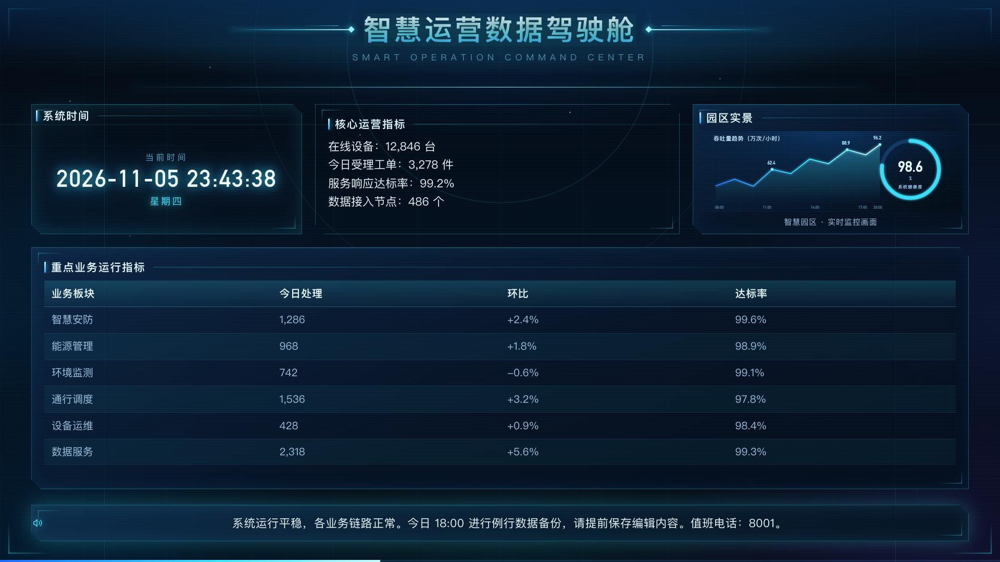
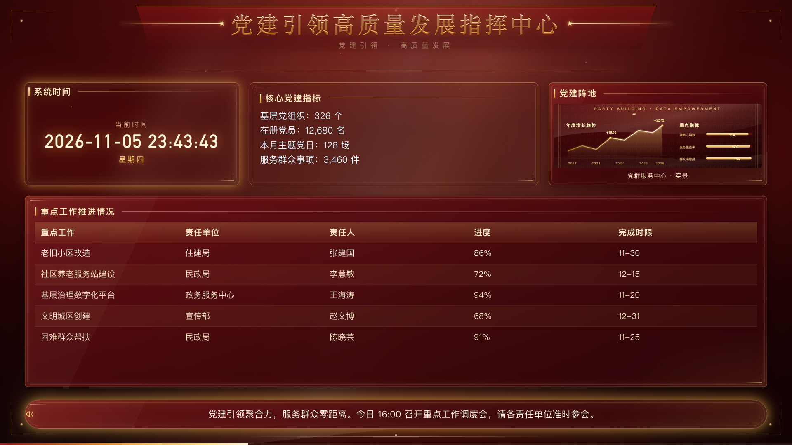
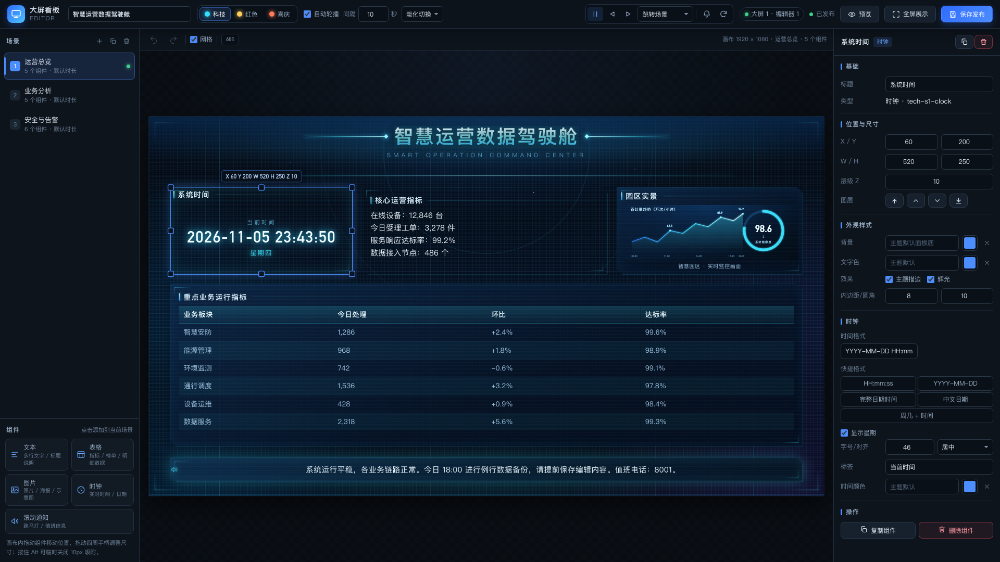

# BigScreen 大屏看板

面向局域网 / 内网的**单文件、零依赖、离线部署**数据大屏系统。一个 Go 二进制同时提供：

- **大屏展示页**：1920×1080 设计画布，自动等比缩放（letterbox），三套主题皮肤，服务端权威轮播；
- **远程编辑器**：可视化拖拽编辑、场景管理、图片上传、模板切换、远程控制与通知；
- **HTTP API + SSE**：配置读写、远程控制、实时事件推送；
- 前端资源全部 `go:embed` 打进二进制，**不依赖任何外网 CDN、Node.js、npm、数据库**。

> 典型部署：一台内网电脑/服务器运行一个二进制文件，大屏电视/一体机用浏览器打开 `http://服务器IP:8080/`，办公电脑打开 `http://服务器IP:8080/editor` 远程编辑。

---

## 0. 效果预览

| 科技风 · 运营总览（kiosk） | 红色风格 · 党建总览 |
|---|---|
|  |  |

| 节日喜庆 · 节日总览 | 远程编辑器（拖拽排版 + 属性面板） |
|---|---|
|  |  |

更多截图与完整验收记录见 **[docs/ACCEPTANCE.md](docs/ACCEPTANCE.md)**。

---

## 1. 页面地址

| 地址 | 说明 |
|---|---|
| `http://服务器IP:端口/` | 大屏展示页（上墙用） |
| `http://服务器IP:端口/?kiosk=1` | 展示页 kiosk 模式（隐藏鼠标与悬浮按钮） |
| `http://服务器IP:端口/?scene=2` | 展示页首次定位到第 3 个场景（0 基） |
| `http://服务器IP:端口/editor` | 远程编辑器 / 控制台 |

默认端口 `8080`；启动时控制台会打印本机所有网卡的局域网访问地址，直接复制使用即可。

---

## 2. 目录结构

```
bigscreen/
├── server/                 Go 后端（标准库，main/store/hub/api/auth/presets/web + 测试）
│   └── web/                前端页面（HTML/CSS/原生 JS，被 embed 进二进制）
├── docs/
│   ├── API.md              接口与数据模型契约（冻结）
│   ├── FRONTEND.md         前端协作契约与主题规范
│   └── ACCEPTANCE.md       v1.0.0 验收报告（功能矩阵/测试/平台构建）
├── screenshots/            效果截图（README / 验收报告引用）
├── scripts/
│   ├── build-all.sh        六平台离线交叉编译
│   ├── start.sh            macOS / Linux / 麒麟 / UOS 启动脚本
│   ├── start.bat           Windows 启动脚本
│   └── screenshot.sh       开发验收用无头浏览器截图（不分发）
├── go.mod
└── README.md
```

### 2.1 架构说明

```
浏览器（大屏展示页 / 编辑器）
        │  HTTP + Server-Sent Events (SSE)
        ▼
┌──────────────────────────────────────────────────────────┐
│ Go 单二进制 bigscreen-server                              │
│  ├─ web.go      内嵌前端资源（//go:embed all:web）+ /uploads │
│  ├─ api.go      REST API、路由、请求日志、鉴权中间件        │
│  ├─ hub.go      SSE Hub：display/editor 连接计数、广播、20s ping │
│  ├─ store.go    dashboard.json 原子写入 + .bak 备份        │
│  ├─ presets.go  三套内置模板（Go 构造 Dashboard）          │
│  ├─ auth.go     可选密码鉴权（启动随机密钥 HMAC Cookie）   │
│  └─ main.go     CLI、启动横幅、局域网地址、优雅退出        │
│  运行态调度：服务端权威轮播（sceneStartedAt/duration）     │
└──────────────────────────────────────────────────────────┘
        │  单目录数据
        ▼
data/dashboard.json + data/dashboard.json.bak + data/uploads/
```

- **服务端权威**：当前场景与播控状态由服务端维护，大屏只负责渲染；保存配置/手动控制会重置场景计时。
- **实时同步**：配置保存、场景切换、播放暂停、在线设备数变化都通过 SSE 秒级推送到所有大屏与编辑器。
- **零运行依赖**：无数据库、无 Node、无外网请求，前端资源全部编译进二进制。

运行后自动生成的数据目录（默认 `./data`）：

```
data/
├── dashboard.json          当前看板配置（服务端原子写入）
├── dashboard.json.bak      上一版本备份（自动生成）
└── uploads/                编辑器上传的图片（/uploads/<文件名> 对外提供）
```

---

## 3. 快速开始（离线部署）

### 3.1 准备发行文件

在任意一台有 Go 1.22+ 的机器上执行（**无需联网**）：

```bash
cd bigscreen
scripts/build-all.sh            # 产物输出到 dist/
```

得到 6 个平台的可执行文件（纯静态，CGO_ENABLED=0）：

| 目标平台 | 文件 |
|---|---|
| Windows 64 位 | `bigscreen-server_windows_amd64.exe` |
| Windows 32 位 | `bigscreen-server_windows_386.exe` |
| macOS Apple 芯片 | `bigscreen-server_darwin_arm64` |
| macOS Intel | `bigscreen-server_darwin_amd64` |
| Linux x86_64（含麒麟/UOS x86） | `bigscreen-server_linux_amd64` |
| Linux arm64（含麒麟/UOS 飞腾/鲲鹏） | `bigscreen-server_linux_arm64` |

把**对应平台的二进制** + `scripts/start.sh`（Windows 用 `scripts/start.bat`）拷到目标机器任意可写目录即可，无需安装 Go、Node、数据库。

### 3.2 Windows

```bat
REM 方式一：双击 start.bat（同目录需有 bigscreen-server_windows_amd64.exe）
REM 方式二：命令行
bigscreen-server_windows_amd64.exe -port 8080 -data .\data -open
```

首次运行如弹出“Windows 已保护你的电脑”，点“更多信息 → 仍要运行”；如被安全软件拦截，请加入信任/白名单。

### 3.3 macOS

```bash
chmod +x bigscreen-server_darwin_arm64    # Intel 机器用 _darwin_amd64
./bigscreen-server_darwin_arm64 -port 8080 -data ./data -open
# 或
./start.sh -open
```

首次运行若提示“无法验证开发者”：右键 → 打开，或 `xattr -dr com.apple.quarantine bigscreen-server_darwin_arm64`。

### 3.4 Linux（含银河麒麟、统信 UOS）

```bash
# 1) 确认 CPU 架构：x86_64 用 linux_amd64；aarch64/arm64（飞腾、鲲鹏、麒麟 ARM）用 linux_arm64
uname -m

# 2) 解压/拷贝后赋可执行权限
chmod +x bigscreen-server_linux_amd64
chmod +x start.sh

# 3) 启动（建议用独立数据目录，避免装在只读目录）
./start.sh -port 8080 -data /opt/bigscreen/data -password 你的密码
# 或直接
./bigscreen-server_linux_amd64 -port 8080 -data /opt/bigscreen/data -open
```

**银河麒麟 / 统信 UOS 注意事项：**

- 二进制为静态编译，**不依赖 glibc 版本**，麒麟 V10、UOS 20 等国产系统可直接运行；
- 若提示“权限不够”或“无法执行二进制文件”：先 `chmod +x`，再确认 `uname -m` 与二进制架构一致；
- 若所在分区以 `noexec` 挂载，换到 `/opt`、`/home` 等可执行目录；
- 图形界面下要自动弹出浏览器需桌面会话已登录且有 `xdg-open`；服务器版请手动在浏览器打开地址；
- 麒麟默认防火墙可能是 firewalld，见第 6 节放行端口；
- 国产浏览器（奇安信、360 极速、UOS 浏览器等 Chromium 内核 90+）均可正常访问；系统自带“火狐”也支持。

---

## 4. 命令行参数

```
bigscreen-server [参数]

  -port int          监听端口（默认 8080）
  -data string       数据目录（默认 "./data"，配置与上传图片都放这里）
  -password string   编辑/控制鉴权密码；空 = 不鉴权（内网演示可用）
  -open              启动后自动打开浏览器展示大屏
  -version           打印版本号后退出
  -h, --help         查看帮助（start.sh / start.bat 支持）
```

常用示例：

```bash
# 内网免登录，启动即打开大屏
./bigscreen-server -open

# 对外提供服务：指定数据目录 + 开启密码
./bigscreen-server -port 8080 -data /opt/bigscreen/data -password 'Admin@2026'

# 换端口避免冲突
./bigscreen-server -port 9090 -data ./data
```

---

## 5. 局域网访问与防火墙

1. 服务默认监听 `0.0.0.0`（所有网卡），启动横幅会打印形如 `http://192.168.1.20:8080/` 的地址；
2. 其他设备用该地址访问即可，**必须与服务器在同一局域网/网段**；
3. 如果本机能开、其他电脑打不开，通常是防火墙未放行端口：

**Windows（管理员 PowerShell / CMD）：**

```bat
netsh advfirewall firewall add rule name="BigScreen 8080" dir=in action=allow protocol=TCP localport=8080
```

或：控制面板 → Windows Defender 防火墙 → 高级设置 → 入站规则 → 新建规则 → 端口 TCP 8080 允许。

**Linux firewalld（麒麟 / CentOS / RHEL 系）：**

```bash
sudo firewall-cmd --permanent --add-port=8080/tcp
sudo firewall-cmd --reload
sudo firewall-cmd --list-ports
```

**Linux ufw（Ubuntu / Debian / UOS 系）：**

```bash
sudo ufw allow 8080/tcp
sudo ufw status
```

**macOS：** 系统设置 → 网络 → 防火墙 → 选项… → 允许 `bigscreen-server` 接收入站连接。

> 提示：部分企业 WiFi/路由器开启了“AP 隔离”，会禁止终端互访，需要网络管理员放行或改用有线网络。

---

## 6. 开机自启（systemd 示例，Linux 服务器 / 麒麟 / UOS）

以 `/opt/bigscreen` 部署、`bigscreen` 普通用户运行、监听 8080 为例：

```bash
sudo useradd -r -s /sbin/nologin bigscreen 2>/dev/null || true
sudo mkdir -p /opt/bigscreen/data
sudo cp bigscreen-server_linux_amd64 /opt/bigscreen/
sudo chown -R bigscreen:bigscreen /opt/bigscreen
```

创建 `/etc/systemd/system/bigscreen.service`：

```ini
[Unit]
Description=BigScreen 大屏看板
After=network.target

[Service]
Type=simple
User=bigscreen
WorkingDirectory=/opt/bigscreen
ExecStart=/opt/bigscreen/bigscreen-server_linux_amd64 -port 8080 -data /opt/bigscreen/data -password 请改成你的密码
Restart=on-failure
RestartSec=3
LimitNOFILE=65535

[Install]
WantedBy=multi-user.target
```

启用并查看状态：

```bash
sudo systemctl daemon-reload
sudo systemctl enable --now bigscreen
sudo systemctl status bigscreen
journalctl -u bigscreen -f          # 实时日志
sudo systemctl restart bigscreen    # 重启
```

---

## 7. 鉴权与安全

- **默认无密码**：不传 `-password` 时，局域网内任何人打开 `/editor` 都能修改大屏。仅建议在完全可信的内网演示环境使用。
- **设置密码**：加 `-password '你的密码'` 后，所有写操作（保存配置、远程控制、上传/删除图片、模板应用、导入、恢复出厂）都必须先登录；大屏展示页与只读接口仍免登录，保证电视端直接出画面。
- 登录态使用服务端启动时随机密钥生成的 **HMAC-SHA256 Cookie**（`bs_auth`，HttpOnly、SameSite=Lax、30 天），**服务重启后自动失效**，需要重新登录，这是有意的安全设计。
- 建议只在**内网**部署使用。如需公网访问，请放在 Nginx 等反向代理之后并启用 HTTPS，同时注意 SSE 需要关闭缓冲：

  ```nginx
  location / {
      proxy_pass http://127.0.0.1:8080;
      proxy_http_version 1.1;
      proxy_set_header Host $host;
      proxy_set_header X-Forwarded-For $proxy_add_x_forwarded_for;
  }
  location /api/events {
      proxy_pass http://127.0.0.1:8080;
      proxy_http_version 1.1;
      proxy_set_header Connection "";
      proxy_buffering off;
      proxy_read_timeout 3600s;
  }
  ```

- 上传接口已做多重防护：最大 20MB、扩展名白名单（png/jpg/jpeg/gif/webp/bmp）、文件头魔数校验、随机文件名、路径穿越拦截。

---

## 8. 数据文件、备份与恢复

所有数据都在 `-data` 指定的目录内：

| 文件 | 说明 |
|---|---|
| `dashboard.json` | 当前看板配置（rev 版本号、主题、场景、组件） |
| `dashboard.json.bak` | 上一个版本的自动备份（每次保存前生成） |
| `uploads/` | 编辑器上传的图片 |

- **配置写入是原子的**（临时文件 + fsync + rename），断电/进程被杀不会写出半截 JSON；主文件损坏时启动会自动回退 `.bak`。
- **备份**（运行时可直接热备份）：

  ```bash
  tar -czf bigscreen-backup-$(date +%Y%m%d-%H%M).tar.gz -C /opt/bigscreen data
  ```

- **恢复**：停止服务 → 用备份覆盖 `data/` → 重新启动。
- **迁移**：把整个 `data/` 目录拷到新机器，配置里引用的图片是相对路径 `/uploads/xxx`，无需改动。
- **恢复出厂**：编辑器里点“恢复默认示例”，或

  ```bash
  curl -X POST http://127.0.0.1:8080/api/reset -b "bs_auth=<登录后的Cookie>"
  ```

---

## 9. 从源码构建

环境要求：Go 1.22+（纯标准库，无需 `go get`，可在完全离线环境构建）。

```bash
cd bigscreen

# 本机运行
go build -o bigscreen-server ./server
./bigscreen-server -port 8080 -data ./data -open

# 六平台交叉编译（输出 dist/）
scripts/build-all.sh
VERSION=1.2.0 scripts/build-all.sh      # 自定义版本号（注入页面/接口 version）
```

验证：

```bash
go vet ./...
go test ./...
CGO_ENABLED=0 GOOS=linux GOARCH=arm64 go build -o /tmp/bigscreen-linux-arm64 ./server
```

---

## 10. 接口与开发说明

- 完整 REST / SSE / 数据模型契约见 **[docs/API.md](docs/API.md)**，前端协作规范见 **[docs/FRONTEND.md](docs/FRONTEND.md)**，验收记录见 **[docs/ACCEPTANCE.md](docs/ACCEPTANCE.md)**。
- 核心接口速览：

| 方法 | 路径 | 说明 |
|---|---|---|
| GET | `/api/health` | 健康检查 |
| GET | `/api/info` | 版本、端口、局域网地址、数据目录、鉴权状态 |
| GET | `/api/config` | 当前配置 + 运行态（免登录） |
| PUT | `/api/config` | 保存配置（需登录；版本冲突返回 409） |
| POST | `/api/control` | play/pause/toggle/next/prev/goto/reload/notify |
| GET | `/api/events?role=display\|editor` | SSE 实时事件流（hello/config/runtime/command/ping） |
| GET | `/api/presets`、`/api/presets/{id}` | 三套内置模板 |
| POST | `/api/presets/{id}/apply` | 应用模板（需登录） |
| POST | `/api/upload`、GET `/api/uploads`、DELETE `/api/uploads/{name}` | 图片上传/列表/删除（需登录） |
| GET | `/api/export`、POST `/api/import` | 配置导出下载 / 导入覆盖（需登录） |
| POST | `/api/reset` | 恢复科技风默认模板（需登录） |
| GET | `/api/auth`、POST `/api/login`、`/api/logout` | 鉴权状态与登录/登出 |

- **配置版本（rev）约定**：客户端从 `GET /api/config` 拿到 `rev`，保存时必须原样回传；服务端比对不一致返回 `409 revision conflict` 并附当前配置。`rev=0` 视为“模板草稿/强制覆盖”（编辑器载入 `GET /api/presets/{id}` 的草稿后直接保存），由服务端重新分配新 rev。
- **轮播由服务端权威调度**：`playing && rotation.auto && 在线展示端 > 0` 时按当前场景 `duration` 推进，并通过 SSE `command{action:"auto"}` 通知所有大屏；没有大屏连接时暂停计时（保留状态），重新有连接后从头计时。保存配置、手动切场景/播放暂停都会重置当前场景计时。
- 开发调试：`server/web/` 下的前端资源在构建时内嵌，改完前端需重新 `go build`。

---

## 11. 常见问题（FAQ）

**Q1：启动报“端口被占用”怎么办？**
换端口：`./bigscreen-server -port 9090 -data ./data`。排查占用：Linux `sudo lsof -i:8080`，Windows `netstat -ano | findstr 8080`。

**Q2：本机能打开，别的电脑打不开？**
依次检查：① 是否用了局域网 IP（启动横幅里的地址）而不是 `127.0.0.1`；② 防火墙是否放行端口（第 5 节）；③ 两台机器是否同一网段、WiFi 是否开了 AP 隔离；④ 云服务器需在安全组放行端口。

**Q3：页面还是旧版本 / 改了前端没生效？**
前端资源内嵌在二进制里，改前端必须重新编译。浏览器缓存可按 `Ctrl+F5`（macOS `Cmd+Shift+R`）强制刷新。

**Q4：编辑器上传图片失败？**
仅支持 png/jpg/jpeg/gif/webp/bmp 且不超过 20MB；检查 `data/uploads/` 是否有写权限（Linux 注意运行用户）。

**Q5：为什么不自动轮播？**
检查：① 编辑器顶部“自动轮播”是否开启；② 是否点了暂停；③ 当前场景 `duration`/轮播间隔是否设置过短或过长；④ **服务端规定没有在线大屏时暂停计时**——打开一个展示页后才会继续推进。

**Q6：服务重启后编辑器要重新登录？**
正常现象：Cookie 使用每次启动随机生成的密钥签名，重启即失效，防止旧 Cookie 长期有效。

**Q7：大屏时钟/进度条不准？**
展示端会按 `hello` 事件里的服务端时间校正偏差；建议服务器开启 NTP 时间同步，避免长时间漂移。

**Q8：Linux 下提示“Permission denied”或无法执行？**
`chmod +x` 二进制与脚本，并确认 `uname -m` 架构与文件后缀一致；若目录是 `noexec` 挂载，换目录部署。

**Q9：如何上墙全屏？**
浏览器打开 `http://服务器IP:8080/?kiosk=1` 后按 `F11`（或浏览器 kiosk 模式）全屏；kiosk 模式会隐藏鼠标与悬浮控制条，避免误触。

**Q10：如何把看板迁移到另一台机器？**
停服务后拷贝整个 `data/` 目录（含 uploads）与新平台二进制，用同样的 `-port/-data` 参数启动即可。

---

## 12. 版本

- 当前版本：`1.0.0`（`bigscreen-server -version` 可查看；构建时可用 `VERSION=x.y.z scripts/build-all.sh` 注入）
- 技术栈：Go 标准库 + 原生 HTML/CSS/JS，单二进制、零外部依赖、完全离线可用。
